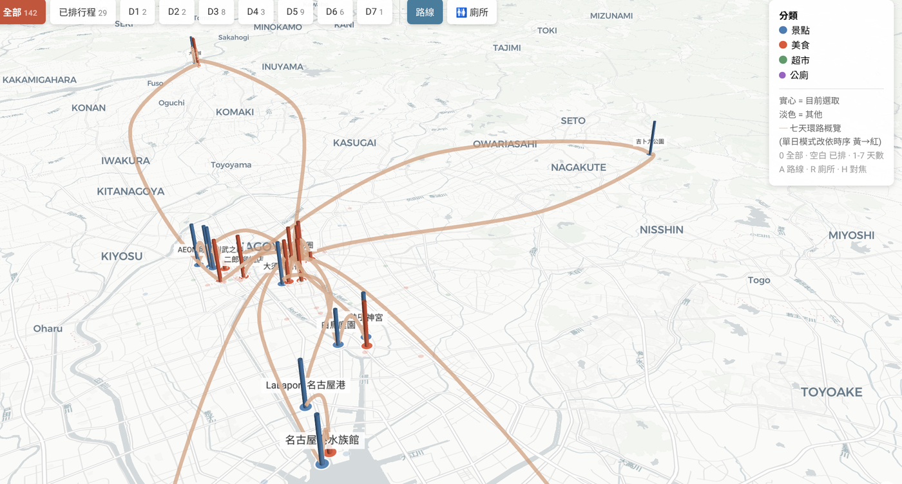
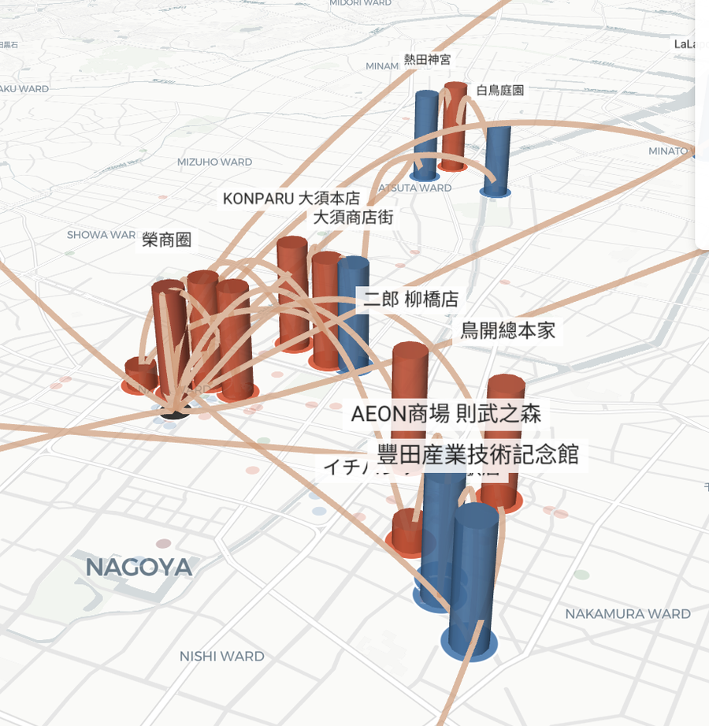

# Nagoya Trip Map

**A data-driven interactive map built from a personal note archive — and an engineering log of everything that went wrong along the way.**

**[→ Live map](https://zoxlu.github.io/Notes-for-trips/static/trip-map/)** · [Full engineering log](docs/engineering-log.md)



<!-- TODO: screen recording of switching between days (the transitions are the best part) -->

142 geolocated places — sights, restaurants, supermarkets — across a seven-day family trip to Nagoya. The source of truth is a set of markdown notes; a Python script turns them into a dataset; deck.gl renders it over a MapLibre base map. The map is in use by my family for trip planning, mostly on phones.

---

## What it does

- **Day filters** — all places, planned only, or a single day (`0`, `Space`, `1`–`7` on a keyboard; buttons on mobile). Buttons are generated from the data, so adding a day to the notes adds a button without touching code.
- **Daily routes** — a closed loop from the accommodation through each day's stops, drawn as a smooth curve that passes exactly through every stop. The overview shows all seven loops at once; single-day mode shows the order as a yellow-to-red gradient.
- **3D view** — tilted camera, routes arched above the ground, and extruded columns whose height encodes how much we want to visit each place.

  

- **Label de-confliction** — labels are chosen per camera position to avoid overlap; zooming in reveals more of them.
- **Nearby restrooms** — toggled with `R`, shown only around the currently highlighted places.
- **Responsive** — works on phones, which is where it is actually used.

## Stack and constraints

| | |
|---|---|
| Data pipeline | Python |
| Rendering | deck.gl 9 (Scatterplot, Column, Path, Text layers) |
| Base map | MapLibre GL 4 with CARTO Positron (no API key) |
| Hosting | GitHub Pages, as an isolated static folder inside a Quartz site |
| Dev machine | 4 GB Chromebook, Linux container |

The machine shaped the design. A full 3D globe (CesiumJS) was out of reach, so this is deck.gl over a 2D base map with data-driven height. And because the development container had no browser to debug library internals in, I preferred algorithms I could extract and **verify numerically in Node** over black-box library features. That turned out to be the most useful constraint in the project (see story 2).

## Architecture

```
Markdown notes (frontmatter)
        │  scripts/build-spots.py — parse, validate, report
        ▼
    spots.json
        │  fetch()
        ▼
  deck.gl layers  ◄──►  MapLibre base map
        │
        ▼
  Interactive map (filters, routes, labels, legend)
```

The notes are the single source of truth. `spots.json` is a generated artefact and is never edited by hand.

Layer stack, bottom to top: routes (`PathLayer`, with z-coordinates) → restrooms → extruded columns → places → accommodation → labels.

---

## Three problems worth telling

### 1. The route didn't touch the places it was routing through

**Problem.** Daily routes were first drawn as straight segments, then smoothed with Chaikin subdivision to round the corners. They looked good — but the curve passed *beside* each stop rather than through it.

**Diagnosis.** Chaikin is a corner-cutting algorithm. It belongs to the family of **approximating** curves (with B-splines and Bézier interior control points): each iteration replaces a vertex with two nearby points, so the curve is only attracted to its control points and never reaches them. This is a property of the curve's definition, not a parameter to tune.

**Fix.** Switched to Catmull-Rom, an **interpolating** spline that passes through every control point by construction. The parameterisation mattered too: segment lengths ranged from about 300 m within the city to 25 km out to Inuyama, and uniform Catmull-Rom overshoots and self-intersects under that kind of spacing. **Centripetal** parameterisation (α = 0.5) exists precisely for this.

To keep out-and-back legs from collapsing onto one line, each segment's midpoint is pushed to the left of the direction of travel, by a fraction of the segment's length. Outbound and return legs travel in opposite directions, so they bow apart into a lens shape automatically — no special case for "same road both ways".

**Verified.** 0.00 m deviation from every stop. Curve length 4–8% longer than the straight polyline, i.e. rounded without overshoot.

### 2. A library feature silently removed every label — so I wrote one I could test

**Problem.** In the seven-day overview, labels piled on top of each other in the city centre. deck.gl's built-in `CollisionFilterExtension` looked like the answer. Enabling it removed **all** labels — including a day with only two places and plenty of space. Not over-aggressive filtering; the whole layer was gone, with no error.

**Diagnosis.** Without a way to inspect the extension's internals, further guessing at its configuration was a dead end.

**Fix.** A small screen-space greedy algorithm: project each candidate to screen coordinates, sort by priority (interest score), keep a label only if its box does not overlap any already kept. It recomputes on every camera change. Written as a standalone function so it could be pulled out of the HTML and run in Node against the real data:

```
zoom 10:  overview  5/30 | Day1 1/2 | Day3 1/8 | Day5 2/9
zoom 12:  overview 10/30 | Day1 2/2 | Day3 2/8 | Day5 3/9
zoom 14:  overview 21/30 | Day1 2/2 | Day3 5/8 | Day5 6/9
zoom 16:  overview 28/30 | Day1 2/2 | Day3 8/8 | Day5 9/9
```
*(measured on the first version; the collision shape has since been refined)*

The collision shape then evolved in three steps, each following the same rule — **the collision test should match the shape of the thing being tested**:

1. **Circle** — over-penalised the vertical direction, since labels are much wider than tall.
2. **Ellipse** — closer, but still one size for every label, and fixed in pixels.
3. **Per-label rectangle** — each label's box is computed from its text (full-width CJK characters ≈ 1 em, half-width ≈ 0.55 em) at the font size it actually renders at for the current zoom. The labels are drawn with a padded rectangular background, so the rectangle is not an approximation — it *is* the rendered shape.

Adding the tilted 3D view introduced one more requirement: labels sit on top of the columns, so the algorithm must project the **raised** position, not the ground position. The column height, the label position and the de-confliction all call one shared `topPosition()` function, so they cannot drift apart.

### 3. The map looked complete — it was missing half the data

**Problem.** The first version of the data script only accepted notes with `type: place`, because that was the type of the note I had looked at. The map rendered normally. It was missing 82 restaurants and, later, 15 supermarkets — and restaurants used a different category field (`food_category`, not `place_category`).

**Diagnosis.** Nothing failed. Skipping unknown types was the script's intended behaviour, so there was no error to notice.

**Fix.** The script now prints the distribution of types, categories and days on every run, plus every file it skipped and why — reconciling collected and excluded against the number of files scanned — and range-checks every coordinate (which also catches the classic lat/lng swap — the notes store `lat,lng`, deck.gl expects `[lng, lat]`).

**It happened again, differently.** Months later the script produced 141 places — the same number as before, so it looked right. In fact one note's frontmatter had been accidentally deleted in the working tree, and the script had quietly skipped it. I caught it only by reviewing every change in `git status` that I had not made myself, before committing. Restored: 141 → 142.

> A number that used to be correct is the most convincing wrong number there is.

---

## How this was built

Built with AI-assisted development (Claude). The design decisions, visual judgement, verification and debugging are my own; the log records where AI-generated code was wrong and how it was caught — for example, a snippet that elided "the unchanged part" with an ellipsis, which I then failed to restore, deleting an entire layer.

I come from over a decade of VFX pipeline work in Houdini, and several ideas here are old friends in a new runtime: deck.gl's per-datum accessors are a point wrangle; normalise-then-map is Houdini's `fit()`; `updateTriggers` and memoisation keys are hand-declared versions of the dependency graph Houdini maintains for you.

## Running locally

```bash
python3 scripts/build-spots.py <notes-folder> spots.json   # regenerate the dataset
python3 -m http.server 8000         # fetch() fails from file:// — serve it
# open http://localhost:8000/
```

## Repository

```
index.html               the map — single file, no build step
spots.json               generated dataset
scripts/build-spots.py   notes → validated dataset
docs/engineering-log.md  all 27 failure modes, grouped by root cause
```

**[→ Read the full engineering log](docs/engineering-log.md)** — grouped into seven families (silent failures, coordinates and space, curves and geometry, visual judgement, library behaviour, environment and deployment, changes that miss a spot), each with its diagnosis and the general rule I took from it.

---

Map data © OpenStreetMap contributors · Base map © CARTO
